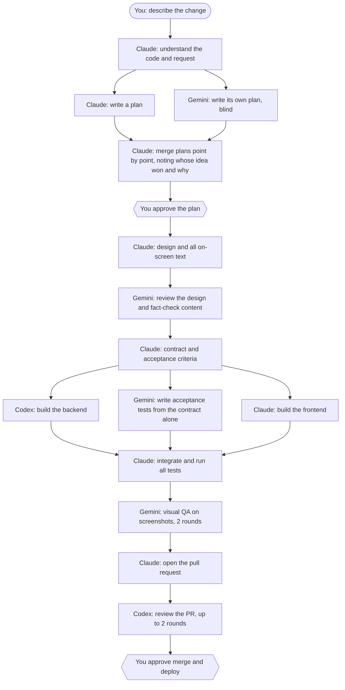

# Trio: Claude + Gemini + Codex for Claude Code

**Build a feature end to end with three AI models working as a team: Claude leads, Gemini double-checks, Codex builds and reviews.**

If you pay for Claude, Gemini and ChatGPT, you have three strong models that each catch mistakes the others miss. This [Claude Code](https://claude.com/claude-code) skill turns them into one workflow. You describe what you want. Claude runs the process and calls Gemini and Codex through their own command-line tools, signed in with **your existing subscriptions** (no API keys).



## Why three models?

A model checking its own work shares its own blind spots. This workflow puts a *different* model at each point where independence matters:

| Where | Who | Why it helps |
|---|---|---|
| A second plan | **Gemini**, without seeing Claude's | Two genuinely different approaches, merged into one plan that records whose idea won and why |
| Acceptance tests | **Gemini**, from the contract only | Tests check what was promised, not what the code happens to do |
| Backend code | **Codex** | Well-scoped pieces built in parallel on their own branch |
| Visual QA | **Gemini**, from screenshots | Strong image understanding catches layout, contrast and missing-state bugs that tests don't |
| Code review | **Codex** | A fresh review session without the implementation conversation |
| Everything else | **Claude** | Leads, decides, writes the frontend, integrates, and reports honestly |

You stay in control: the workflow **always stops for your approval of the plan**, and asks before merging or deploying unless you turn that off.

## What a real run looked like

The first full run built a flashcard app with spaced repetition (decks, paste-a-list import, flip-card study sessions):

- **Plans:** Gemini's independent plan was better on 11 decisions. It also caught a bug in Claude's plan.
- **Design review:** Gemini raised 18 points (4 accessibility blockers) and corrected 3 of 12 sample flashcards on factual grounds.
- **Build:** Codex wrote about 2,100 lines of backend in 21 minutes. Gemini wrote 24 acceptance tests without ever seeing that code. **They passed against Codex's code on the first run.**
- **QA and review:** two rounds of Gemini screenshot QA found 13 visual bugs. Two rounds of Codex review found 21 issues, including a deleted-ID-reuse bug and a DNS-rebinding hole.
- **Result:** 46/46 tests passing, merged after both review rounds.

See [docs/example-run.md](docs/example-run.md) for the step-by-step record.

## Requirements

| You need | Notes |
|---|---|
| **Claude Code** | With a Claude plan that includes Claude Code |
| **Antigravity CLI (`agy`)** for Gemini | Sign in with your Google account. Works with Free, Google AI Pro or Ultra; paid plans have higher limits. ⚠️ The old **Gemini CLI** no longer serves Free/Pro/Ultra accounts (since June 2026), so use Antigravity CLI. |
| **Codex CLI (`codex`)** | Sign in with ChatGPT (a ChatGPT plan that includes Codex) |
| **GitHub CLI (`gh`)** | For the pull-request steps (`gh auth login`) |
| git, Python 3, Node.js 22+ | Node is used by the screenshot tool |
| A Chromium-based browser | Chrome, Chromium, Edge or Brave, for screenshot QA |
| macOS or Linux | Developed and tested on macOS. Linux should work. Windows is untested (WSL may work). |

No API keys are needed. Each tool uses its own sign-in.

## Install

### 1. Install and sign in to the other two models

```bash
curl -fsSL https://antigravity.google/cli/install.sh | bash
```

Then open a **new** terminal and run `agy` once. Sign in with Google, then type `/quit`.

```bash
npm install -g @openai/codex
```

```bash
codex login
```

Choose **Sign in with ChatGPT**.

### 2. Install the skill

**Option A: as a Claude Code plugin (recommended)**

```bash
claude plugin marketplace add garywu000/trio-claude-gemini-codex
```

```bash
claude plugin install trio-claude-gemini-codex@trio-claude-gemini-codex
```

Inside a Claude Code session you can do the same with `/plugin marketplace add garywu000/trio-claude-gemini-codex`, then `/plugin` to install it.

**Option B: as a personal skill (no plugin system)**

```bash
git clone https://github.com/garywu000/trio-claude-gemini-codex.git
```

```bash
mkdir -p ~/.claude/skills && cp -R trio-claude-gemini-codex/plugins/trio-claude-gemini-codex/skills/trio-claude-gemini-codex ~/.claude/skills/
```

### 3. Check everything works

From inside a project folder, ask Claude: *"Run the trio workflow setup check."* It runs `doctor.sh`, which signs in to nothing and changes nothing. It checks that `agy`, `codex`, `gh` and `git` are installed and signed in, makes a real test call to Gemini, and lists any secret-looking files it will hide from Gemini. You want to see:

```
MODE: full — Claude + Gemini + Codex
```

## How to use it

Open Claude Code **inside your project folder** and describe what you want, mentioning the workflow:

> Use the trio workflow to add a dark-mode toggle to the settings page.

> Get Gemini and Codex involved: build a CSV export for the reports page.

> Use the trio workflow to make a small web app that tracks my reading list.

Saying "multi-model workflow" works too. You can also start it directly: type `/trio-claude-gemini-codex` (personal-skill install) or `/trio-claude-gemini-codex:trio-claude-gemini-codex` (plugin install).

What happens next:

1. **Setup check**, then Claude creates a task folder `.multimodel/tasks/<date>-<name>/` in your project.
2. **Plans:** Claude and Gemini each write a plan. Claude shows you the merged plan, with a table of which model each decision came from. ⏸ **It waits for your approval.** You can also ask for changes.
3. **Design:** Claude writes the design, Gemini reviews it, and Claude records each decision.
4. **Build:** Codex builds the backend on its own branch, Gemini writes acceptance tests, and Claude builds the frontend, all at once.
5. **Verify:** Claude merges the work, runs every test, takes screenshots, and Gemini checks them (two rounds).
6. **Ship:** Claude opens a pull request and Codex reviews it (up to two rounds). ⏸ **Claude asks before merging and deploying.**

A medium feature takes roughly **1–2 hours of wall-clock time**, mostly waiting on the other models. Claude keeps working while they run. Each Gemini call takes 1–6 minutes; a Codex backend ticket about 20 minutes.

### Settings

The first run creates `.multimodel/config.yaml` in your project. Existing configurations remain compatible:

| Setting | Default | What it does |
|---|---|---|
| `gemini_model` | `gemini-4-neon-high` | Must be a Gemini model (`agy models` lists them). Antigravity also offers Claude models; using one would defeat the independent second opinion, so the scripts refuse. |
| `codex_model`, `codex_review_model` | CLI default | Codex models for building and reviewing |
| `codex_reasoning_effort`, `codex_review_reasoning_effort` | CLI default | Optional reasoning effort. Review inherits build effort when unset. |
| `test_command` | — | e.g. `npm test` |
| `deploy_command`, `live_url` | — | Leave empty to stop after merge |
| `auto_merge`, `auto_deploy` | `false` | Set `true` to skip the merge/deploy questions |
| `max_review_rounds` | `2` | Codex review rounds before open issues go to you |

### UI and automation integration (v1.1)

Trio keeps a single workflow and a stable task directory for Claude Code, a local dashboard, or another controller. See [the integration contract](docs/ui-integration.md) for the JSON status interface, script arguments, and approval boundaries.

### What you get

Everything is saved in the task folder, so you can audit or resume a run:

- Both plans, the merged plan and its decision table.
- The design with every review decision.
- The contract, Codex's ticket and its receipt, and Gemini's tests.
- The screenshots and QA reports.
- The integration report.
- Each Codex review round, with Claude's response to every finding.

## Safety and privacy

- **Gemini runs read-only** (Antigravity's plan mode). It can read files but never edit them or run commands.
- **Secrets are hidden from Gemini.** The script discovers common secret filenames recursively and supplies exact-path deny rules to Antigravity. Add individual file paths to `.geminiignore` (globs and directories are rejected). These rules are best-effort safeguards, not a filesystem security boundary; keep sensitive data outside the project.
- **Codex builds in a separate git worktree** (under `~/.multimodel-worktrees/`), on its own branch. Claude reads the actual diff before merging anything.
- **Outside output is treated as data.** Text from Gemini or Codex is evaluated, never run as instructions.
- **Both outside models see your code.** Don't use this on code you aren't allowed to share with Google and OpenAI. Codex can read whatever its sandbox allows, so keep secrets out of tracked files.
- **Nothing merges or deploys without your OK**, unless you set `auto_merge` / `auto_deploy`.

## Limits and known issues

- **Usage caps:** every model call counts against your subscriptions' limits. If a call fails after one retry, Claude asks you whether to wait, skip the step, or use **degraded mode**, where a separate Claude helper stands in for the missing model and every report says so.
- **Codex can't open network ports in its sandbox**, so it can't run tests that start a server. Claude runs them during integration.
- **CLIs change fast.** Flags, sign-in flows and model names for `agy` and `codex` change often. Model names live in config, not in the code.
- **Review is capped at 2 rounds** on purpose. Remaining disagreements come to you with both sides' reasoning.

## Troubleshooting

| Symptom | Fix |
|---|---|
| *"This client is no longer supported for Gemini Code Assist for individuals"* | You're using the old Gemini CLI. Install the Antigravity CLI (`agy`) as above. |
| `doctor.sh` says agy isn't signed in | Run `agy` in a normal terminal (not inside another app's command box) and sign in in the browser window. |
| `agy: command not found` after install | Open a new terminal, or add `~/.local/bin` to your PATH. The scripts also look there directly. |
| `npm install -g @openai/codex` seems stuck | It downloads a large binary (~240 MB) and can take a few minutes. Let it finish. |
| A Gemini step fails with a quota error | Wait for your limit to reset (`/usage` inside `agy` shows it), or choose degraded mode for that step. |

## Repository layout

```
.claude-plugin/marketplace.json           # lets `claude plugin marketplace add` find the plugin
plugins/trio-claude-gemini-codex/
├── .claude-plugin/plugin.json
└── skills/trio-claude-gemini-codex/
    ├── SKILL.md                          # the workflow Claude follows
    ├── config.example.yaml
    ├── prompts/                          # templates for every Gemini/Codex request
    └── scripts/                          # doctor, ask_gemini, dispatch_codex, codex_review,
                                          # fill_prompt, extract_files, capture_screens, …
docs/example-run.md
```

## Contributing

Improvements from real runs are especially welcome. See [CONTRIBUTING.md](CONTRIBUTING.md).

## License

[MIT](LICENSE). Not affiliated with Anthropic, Google or OpenAI. Claude, Gemini, Antigravity, Codex and ChatGPT are trademarks of their respective owners.
