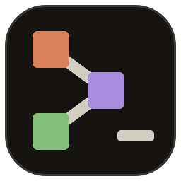
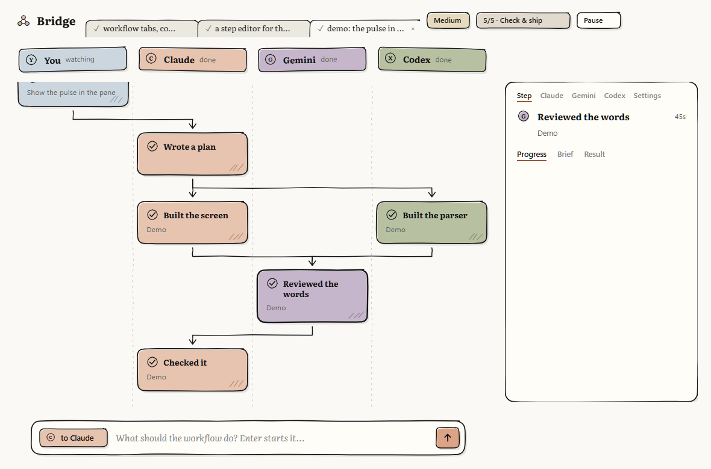
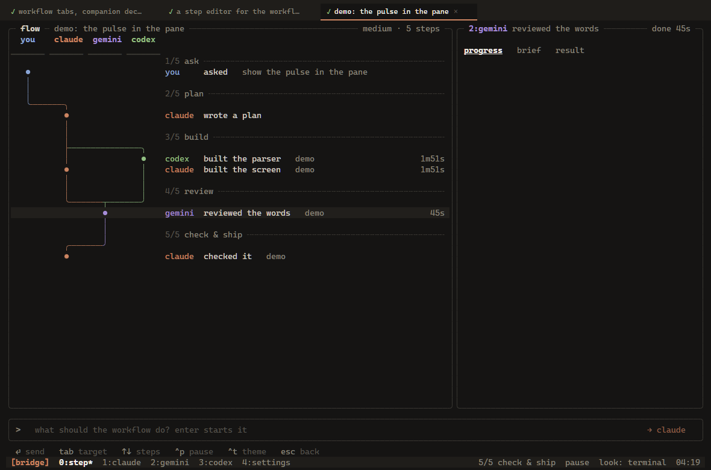
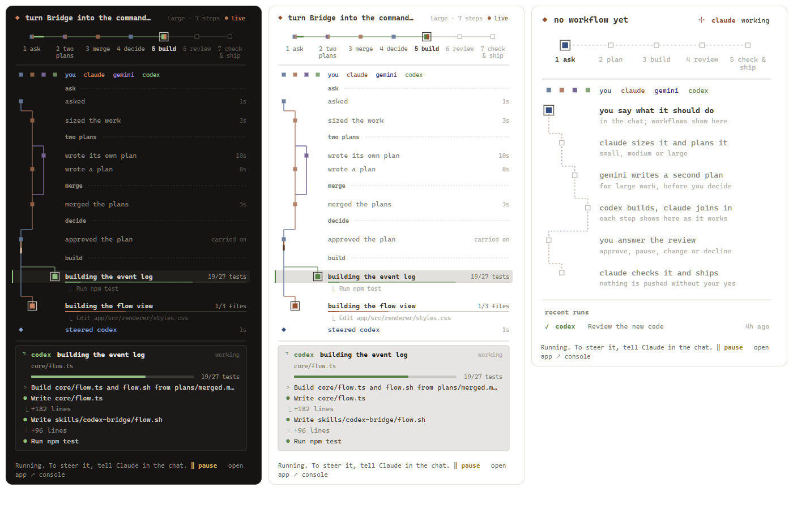

<p align="center">
  
</p>

<h1 align="center">Bridge</h1>

<p align="center"><b>Claude leads, Codex builds, Gemini double-checks, and you watch all three at work.</b><br>
A Claude Code plugin and a desktop app, on the subscriptions you already have.</p>

<p align="center">
  
  
  
</p>

<p align="center">
  
</p>

Bridge lets Claude hand routine work to OpenAI Codex, so your ChatGPT plan does the token-heavy work and your Claude usage goes further, without lowering quality. It can also ask Gemini (through Google's Antigravity CLI) for an independent second plan and a review of interaction and copy. The three share a project folder, so what one learns the others see.

The desktop app, also called **Bridge**, is the command center: every workflow, in any folder or session, runs live in its own tab, lane by lane. You review a plan when it is ready (it carries on by itself after 30 seconds), and steer, pause or decline at any point. A companion bar keeps every workflow in view over your other windows, and the same picture sits in a pane beside the chat in Claude Code.

<table>
  <tr>
    <td width="58%"></td>
    <td></td>
  </tr>
  <tr>
    <td align="center"><sub>The terminal look</sub></td>
    <td align="center"><sub>The pane beside the chat, on dark or white</sub></td>
  </tr>
</table>

<details>
<summary><b>What's new</b></summary>

- **0.6.3** Ask Codex from the pane opens Bridge on its Codex page; a companion switch you can see; the companion stays above other windows.
- **0.6.2** Bridge in the Start menu; the companion always on; the pane on white; the drawn look's tabs fixed.
- **0.6.0** The steps of each workflow size are yours to edit.
- **0.5.0** Every workflow at once, in tabs, and the companion as a deck.
- **0.4.0** The Bridge pane beside the chat in Claude Code.
- **0.3.0** The shared project and the Bridge app.

</details>

```
Claude (plans, routes, checks the result, writes the frontend)
  ├─> Codex CLI (GPT model on your ChatGPT plan): bounded blocks, diff reviews
  └─> Gemini via Antigravity CLI (optional): second plan, interaction and copy review
```

## The workflow

Claude sizes every task first and tells you which size it picked; you can change it.

- **Small** (a fix, a question, a quick change): Claude alone. Ask, Do, Check.
- **Medium** (a bounded feature across a few files): Claude plans and leads; Codex builds one bounded block or reviews the diff once; Gemini takes a quick look where it helps. Ask, Plan, Build, Review, Check & ship.
- **Large** (a new area, a redesign, unclear requirements, a release): the full flow.
  1. You say what you want.
  2. Claude writes a plan; Gemini writes its own without seeing Claude's.
  3. Claude merges them item by item, marking whose idea was adopted and why the other wasn't. You decide.
  4. Claude defines the interfaces and the acceptance checks, hands self-contained backend tasks to Codex, and writes the UI and other design-sensitive code itself.
  5. Gemini reviews the interaction and copy; Codex reviews the diff, at most two rounds.
  6. Claude runs the checks.

In every size nothing is committed, pushed or published without your yes. Without Antigravity CLI, Gemini's parts are skipped.

These are the default steps. Change them in Bridge under **Settings › Steps**: each size is a line of steps, the way the flow shows them. Click a step to set who does it, how much Codex builds, how many review rounds, and whether you review after it (a review that carries on after the wait, or one that needs your yes); add, move or remove steps. "Ask" stays first and "Check & ship" last, Claude always plans, merges and checks, and Gemini never builds (it can't edit files). Your steps are saved in `workflow.json` in the plugin folder; the app, the companion and the Claude Code pane show them, and Claude follows them (`flow.sh steps <size>` prints them).

## What's inside

The plugin has five parts:

- **A skill** that tells Claude what to hand off (edits, tests, code reading, reviews), what to keep (hard problems, design taste, anything that publishes or touches secrets), how to brief Codex, and to check every result before showing it to you.
- **A job script** (`skills/codex-bridge/pyr.sh`) that runs one Codex job and gives Claude only Codex's final answer, not the long log.
- **A Gemini script** (`skills/codex-bridge/agy.sh`) that runs one Gemini job through Antigravity CLI. Gemini answers in text only: it can read files but cannot edit them or run commands, and the script never bypasses Antigravity's permission checks.
- **The Bridge pane** beside the chat (`/codex` opens it), drawn in the app's look, terminal or hand-drawn. It shows the whole workflow on top, every step in its lane, and the step in focus below (what it is doing, or the review's points and countdown). Approve, pause or decline a review there; anything you want to say (a workflow to start, a note to steer, a change to a review) goes in the chat beside it. With no workflow it shows how one goes, the last workflow and the recent Codex and Gemini runs; click a run for its brief and reply. **Ask Codex ↗** opens Bridge on its Codex page with the box addressed to Codex, to ask it straight without Claude in between. It is laid out for the pane's width, wide or narrow. In the terminal look it sits on dark or on white (for Claude Code's light theme): set "Claude pane" in Bridge's settings.
- **The Bridge app** (below), with the console as a fallback inside Claude Code for terminal and SSH use.

## The Bridge app

The command center for the three agents. You start in Claude as always; when Claude runs a workflow, Bridge shows it live:

- **The flow**: lanes for You, Claude, Gemini and Codex, a box per step going down the page, lines between the steps that follow each other. Whatever is working right now is highlighted and shows what it is doing and how far it has got. Click a step to open it.
- **The review**: when a plan is ready, Bridge tells you (a notice, and the companion bar) and waits 30 seconds. Approve, pause, steer (type what to change) or decline; with no answer it carries on with the plan. Anything that pushes or publishes waits for a real yes.
- **The tabs**: one per workflow, in whatever folder or Claude Code session it runs, in the order they started. Each says whether its workflow is working, waiting for you, paused or done, and where it runs. Ctrl+Tab and Ctrl+1..9 switch, Ctrl+W hides a tab (the workflow keeps running; it comes back when it needs you), Ctrl+Shift+T brings the last one back. Each workflow keeps its own pause, answers and notes, so two in one folder stay apart.
- **The steer box** at the bottom: plain text goes to Claude (picked up at its next step while it works, or as a new prompt when it is idle); start with `@codex` or `@gemini` to ask that agent directly, and its run appears in its lane.
- **The side pane**: the selected step (progress, brief, result), a page per agent, and the settings (folder, look, the Claude Code pane on dark or white, companion, Codex model and effort, whether Codex may edit files).
- **Two looks**: a terminal program, and a hand-drawn one. Switch with Ctrl+T or in the settings.
- **The companion bar**: a small bar that floats over other windows, with Approve and Pause right in it. It is always on: close Bridge's window and the bar stays, so you can follow every workflow and agent without the Claude app or the window; right-click it to open Bridge again or quit. Hover it for the steps and the latest events. With several workflows it is a deck: the one that needs you is on top, the others peek behind it, and the count on its corner brings the next one up. Its buttons answer the card on top; click the card to open its tab. In the settings it can instead show only while work runs, or stay off.
- **The review queue**: when reviews that carry on by themselves wait in several workflows at once, only the one on top counts down; the others wait their turn and get their full 30 seconds when it comes, so nothing is approved while you can't see it.

Claude writes the flow with `skills/codex-bridge/flow.sh` (the skill says when); Codex and Gemini runs join it by themselves. Everything is in `.bridge/flow.jsonl` in your project, one line per event, plus `.bridge/control/` for your answers.

Open it with **Open app** on the pane or `/bridge`. On Windows it also adds itself to the Start menu the first time it opens: search for **Bridge** to open it like any app, or pin it to the taskbar from there. Opened that way after a plugin update, it builds itself again first. Set it up once (it needs Node.js):

```bash
cd <plugin folder>/app
npm ci
```

`/bridge` says where the plugin folder is if the app isn't set up yet. The app runs from the plugin folder; there is no installer (the Start menu entry points there).

## The console

`/bridge console` opens a pane beside the chat that works like a small terminal for Codex and Gemini, for when the app can't open (a terminal or SSH session, or before the app is set up); in the desktop app, Codex and Gemini are asked in Bridge itself. Its top row picks who answers, the Codex model, the effort and whether Codex may edit files. Type a prompt and press Enter; a follow-up continues the same conversation until `/new`.

| Command | Does |
|---|---|
| `/codex`, `/gemini` | switch who answers |
| `/new` | start a fresh conversation |
| `/model <name>` | Codex model (`gpt-6.2-sol`, `gpt-6.2-astra`, `gpt-6.1-sol`) |
| `/effort <level>` | effort for the current AI, or `default` |
| `/mode read` / `/mode write` | whether Codex may edit files in the folder |
| `/stop` | stop the running prompt |
| `/project`, `/project start <goal>` | show or start the shared project |
| `/note <text>` | add a note to the shared log |
| `/claude [text]` | ask Claude with the last reply attached; alone, put the last reply in your prompt box |
| `/stage <step>` | move the workflow (ask, plan, merge, decide, build, review, ship), or `next` |
| `/size <size>` | how much workflow: `small`, `medium` or `large` |
| `/clear`, `/help` | clear the transcript, list commands |

Every console prompt, in the app or the pane, runs through the job scripts, so it shows in the run list.

## The shared project

So that Claude, Codex and Gemini work from the same facts, a project lives in a `.bridge/` folder in your working folder:

- `project.md`: the goal, who does what (Claude leads, plans, writes the UI and checks; Codex takes self-contained backend tasks and reviews diffs; Gemini writes the second plan and reviews copy; you decide), decisions and open questions.
- `log.md`: what each agent was asked and answered, plus your notes and Claude's handoffs.

Start one from the app's Workflow screen, or `/project start <goal>` in a console. From then on every Codex and Gemini job is told to read both files, and its reply is added to the log; Claude's skill tells it to read them before working and to record decisions. Add `.bridge/` to `.gitignore` if you don't want it committed. `BRIDGE_PROJECT=off` leaves a job out.

## Requirements

- Claude Code (terminal or desktop app).
- The Codex CLI, signed in with your ChatGPT account:

  ```bash
  npm install -g @openai/codex
  codex login
  ```

  On Windows, if the Codex desktop app is installed, the script uses the Codex CLI bundled with it, which is often newer than an old npm install.
- `bash`. On Windows that is Git Bash, which Claude Code already uses.
- Optional, for Gemini: [Antigravity CLI](https://antigravity.google/download), signed in once by running `agy` (a personal Google account; Google AI Pro raises its limits), and `node` on PATH to read its replies. Gemini CLI no longer serves personal accounts.

## Install

At the prompt of a Claude Code terminal session:

```
/plugin install codex-bridge --marketplace Flzsh/claude-bridge
```

From a shell:

```bash
claude plugin install codex-bridge --marketplace Flzsh/claude-bridge
```

In the desktop app, where `/plugin` does not run: click + next to the prompt box, then Plugins, Add marketplace with `Flzsh/claude-bridge`, then Add plugin.

Answer `y` to add the marketplace and pick the user scope. The band appears in sessions started after the install.

## Choosing the model

By default jobs run on `gpt-6.2-sol` at `high` reasoning effort, which suits a ChatGPT Plus quota. The skill has a short reference (from Artificial Analysis) that Claude checks before picking another model or effort for a job. To change the defaults, set these in the `env` block of `~/.claude/settings.json`:

```json
{
  "env": {
    "CODEX_BRIDGE_MODEL": "gpt-6.2-sol",
    "CODEX_BRIDGE_EFFORT": "high"
  }
}
```

`CODEX_BIN` points the script at a specific `codex` executable.

If your `~/.codex/config.toml` sends Codex through a local proxy (`openai_base_url`) that refuses it, a failed job prints a hint. Set `CODEX_BRIDGE_BASE_URL` to `https://chatgpt.com/backend-api/codex` to send this plugin's jobs straight to ChatGPT; your config file is left alone.

For Gemini, set these in the same `env` block if needed: `AGY_BIN` points at a specific `agy` executable; `AGY_MODEL` and `AGY_EFFORT` override Antigravity's defaults by passing `--model` and `--effort`.

## How a job runs

1. Claude writes a short brief: a title line, the goal, the files involved, what not to touch, the checks to run, and the reply format.
2. `pyr.sh <workdir> <brief-file> [read-only|workspace-write]` runs `codex exec` in that folder with that sandbox. It never uses full access.
3. The run is saved in the plugin's `runs/` folder (brief, log, reply, status), which is what the band, the app and the console read.
4. Claude reads the reply, checks the diff and runs the checks itself. If the work is wrong it sends one correction, then finishes the job itself.

## License

MIT
